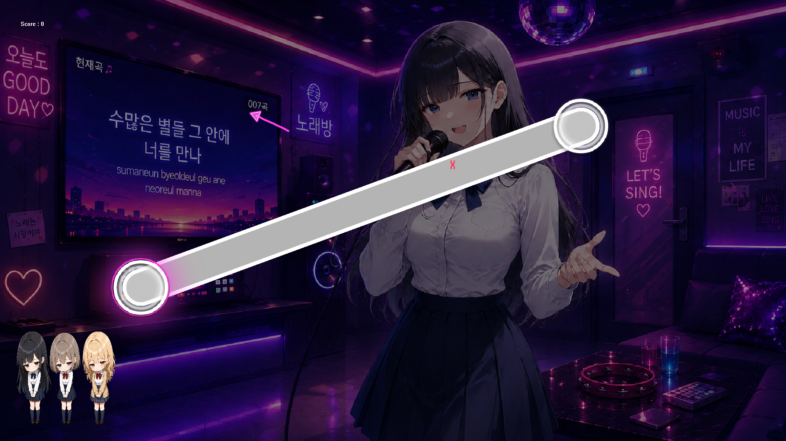
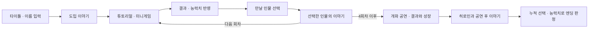
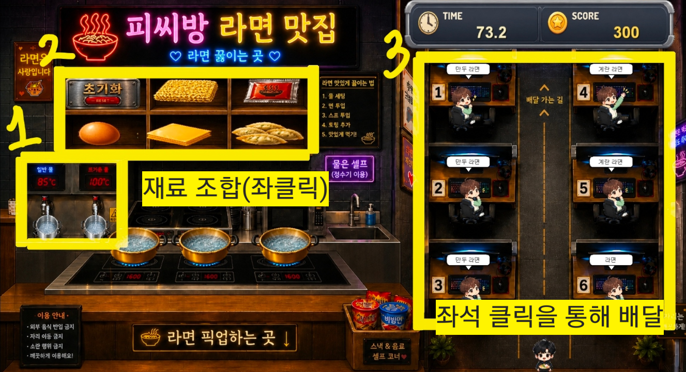
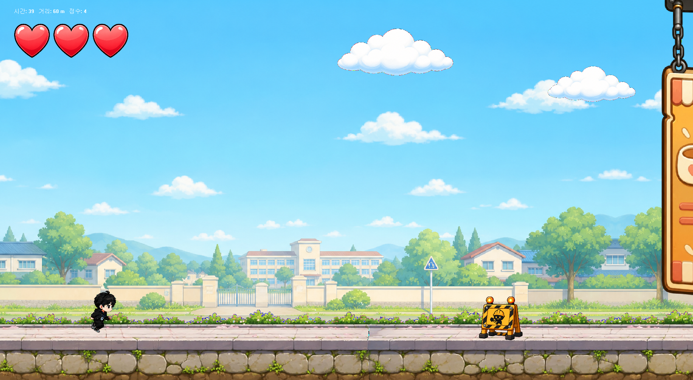
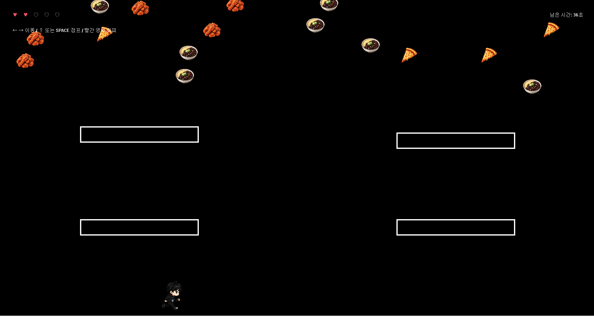
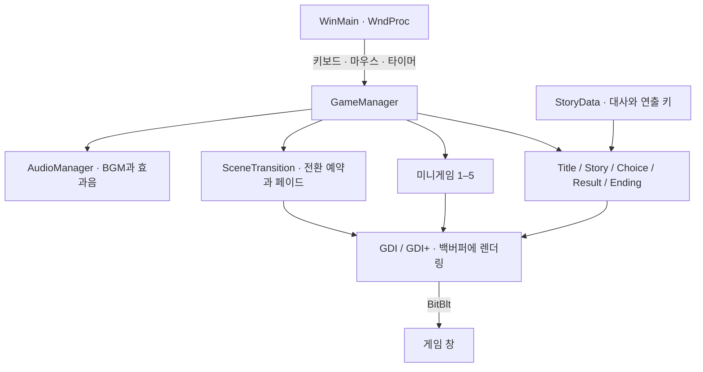

<div align="center">
  <h1>고백은 세이브 로드가 없다</h1>
  <p><strong>NO SAVE LOVE · 선택과 플레이가 엔딩으로 이어지는 Win32 비주얼노벨</strong></p>
  <p>게임 · Windows PC · 2인 팀 프로젝트</p>
  <p><a href="#플레이와-조작">플레이</a> · <a href="#구현-구조">구현</a> · <a href="#실행과-빌드">실행</a> · <a href="#팀과-크레딧">팀 역할</a></p>
</div>

**NO SAVE LOVE · 선택과 실력으로 반복되는 봄을 끝내는 학원 로맨스**

혼자 남으면 다시 시작되는 봄. 누군가와 함께 보내는 하루만이 앞으로 나아간다.
PC방에서 라면을 만들고, 노래를 연습하고, 등굣길을 달리고, 유혹을 피하며 다음 만남을 준비한다. 마지막에는 작은 무대에서 개화를 부른다.
**누구를 만나느냐와 어떻게 플레이하느냐가 함께 결말을 만드는 비주얼노벨**이다.



*박자를 맞추다 보면 게임 창 자체가 작아지고 이동한다. 위 이미지는 저장소의 발표 자료에 수록된 플레이 화면이다.*

`C++20` · `Win32 API` · `GDI / GDI+` · `Windows 멀티미디어 API`

2026-1 윈도우프로그래밍 기말 팀 프로젝트 · 김새누 & 최윤서

| 구분 | 내용 |
| --- | --- |
| **개발 형태** | 2026-1 윈도우프로그래밍 기말 팀 프로젝트 · 김새누 & 최윤서 |
| **최윤서 담당** | 공동 프로그래밍, 시나리오, 등교길, 유혹피하기 · [크레딧 근거](docs/CREDITS.md) |
| **구현 결과** | 다섯 미니게임의 결과와 인물 선택을 연결한 7개 엔딩 |
| **기술 포인트** | 장면 상태와 입력 분배, GDI 백버퍼 재사용, 지연된 장면 전환 |

## 어떤 게임인가요?

폐부를 앞둔 문예부실 근처에서 발견한 검은 노트. 그 안의 문장은 평범한 학교생활을 바꿔 놓는다.
플레이어는 차분한 학생회장 **한세아**, 장난스러운 분위기 메이커 **유하린**, 조용한 문예부 소녀 **서이린**과 만나며 반복되는 봄에서 벗어날 방법을 찾는다.

- **이야기 사이에 들어가는 다섯 미니게임.** 요리·노래 연습·러닝·회피와 히로인이 응원하는 개화 공연을 연결했다.
- **플레이 결과가 남는 만남.** 미니게임 성적은 재력·대화 스킬·매력·외모로 환산되고, 인물 선택 기록과 함께 엔딩 판정에 쓰인다.
- **Win32 창도 연출의 일부.** 리듬게임은 노트 판정과 창의 크기·위치 변화를 결합한다.
- **대사에도 움직임과 소리.** 이름 치환, 타이핑, 캐릭터 페이드, 흔들림, 장면별 BGM을 지원한다.

세 인물에 대한 **4회차 × 3인, 총 12개 분기 대사 묶음**이 있으며, 엔딩은 **7가지**다.
한 번의 플레이에서 모든 분기를 읽는 구조는 아니다. 자세한 엔딩 조건은 아래 접힌 영역에 분리했다.

## 플레이와 조작



미니게임은 아래 순서로 진행된다. 매번 튜토리얼을 거쳐 조작을 익히고, 결과 화면에서 능력치 변화를 확인한다.

| 미니게임 | 플레이 목표 | 주요 조작 | 성장하는 능력치 |
| --- | --- | --- | --- |
| **PC방 알바** | 주문에 맞춰 라면을 조리하고 손님에게 배달하기 | 마우스로 재료·조리 도구·좌석 선택, `1`–`6`으로 좌석 배달 | 재력 · 대화 스킬 |
| **노래연습** | 타이밍에 맞춰 원을 누르고 슬라이더 따라가기 | 마우스 왼쪽 클릭·누른 채 이동 | 매력 · 외모 |
| **등교길** | 장애물을 피하면서 젤리 수집하기 | `Space` 점프·2단 점프, `↓` 슬라이딩 | 외모 · 매력 |
| **유혹피하기** | 게임·음식·휴대폰 등 여러 장애물에 맞지 않고 버티기 | `←` `→` 이동, `Space` 또는 `↑` 점프·2단 점프, `↓`+점프 발판 내려가기 | 대화 스킬 · 재력 |
| **개화 공연** | 곡선 꽃길·기억 꽃·히로인 릴레이·앵콜·거울 배치를 따라 120초 공연하기 | 마우스 왼쪽 클릭·누른 채 이동 | 대화 스킬 · 매력 |

대사는 **왼쪽 클릭**으로 진행한다. 글자가 나오는 중에는 문장 전체를 먼저 표시하고, 다음 클릭에 다음 줄로 넘어간다.
`SKIP`은 현재 대사 묶음을 건너뛴다. `Esc`는 종료 확인창을 열며, 다시 누르면 닫는다. 개화 공연에서는 음악과 판정도 함께 일시정지된다. [개화 기믹·채보·검증](No_Save_Love/docs/flowering_minigame.md), [다섯 게임 성장 밸런스](No_Save_Love/docs/minigame_balance.md).

### 플레이 화면

| PC방 알바 | 등교길 | 유혹피하기 |
| --- | --- | --- |
|  |  |  |
| 조리 순서와 주문 처리를 함께 관리한다. | 점프와 슬라이딩으로 장애물을 넘고 젤리를 모은다. | 공격 패턴을 읽고 남은 체력을 지킨다. |

이미지 4장은 **기존 게임 튜토리얼에 사용된 플레이 화면**이다. 리듬·PC방·등교길 화면은 [게임 소개 발표 자료](No_Save_Love_게임_소개.pptx)의 3번 슬라이드에도 수록되어 있다.
원본 그대로 추출·복사했으며, PC방 알바 화면에는 노란 설명 표시가 포함되어 있다. 이번 문서 작업에서 새로 실행·촬영한 화면은 아니므로 현재 빌드와 일부 표시가 다를 수 있다.

<details>
<summary>엔딩 분기 규칙 보기 — 조건 스포일러 포함</summary>

4번의 만남에서 가장 많이 선택한 인물이 최종 대상이 된다. 동률이면 코드의 인물 순서인 **한세아 → 유하린 → 서이린**이 우선한다.

1. 네 능력치의 합이 **80 이하**이면 공통 히든 엔딩으로 진행한다.
2. 그 외에는 최종 대상의 조건을 확인한다.

| 최종 대상 | 해피 엔딩 조건 | 조건 미달 |
| --- | --- | --- |
| 한세아 | 재력 + 대화 스킬 ≥ 120 | 해당 인물의 배드 엔딩 |
| 유하린 | 대화 스킬 + 매력 ≥ 120 | 해당 인물의 배드 엔딩 |
| 서이린 | 매력 + 외모 ≥ 120 | 해당 인물의 배드 엔딩 |

따라서 **인물별 해피 3종 + 배드 3종 + 공통 히든 1종**이다. 마지막에 별도의 인물 선택창을 한 번 더 띄우는 방식이 아니라, 누적 선택을 기준으로 판정한다.

근거: [GameManager.cpp](No_Save_Love/No_Save_Love/GameManager.cpp)의 `PrepareFinalChoiceIntro`, `CalculateEndingType`, `EnterEndingStory`

</details>

## 구현 구조

상용 게임 엔진을 사용하지 않고 **Windows 메시지 처리, 화면 그리기, 장면 상태, 입력, 오디오를 직접 연결**했다.
`GameManager`가 현재 모드를 기준으로 입력과 업데이트를 분배하고, 각 Scene과 미니게임이 자기 화면과 상태를 관리한다.



| 구현 포인트 | 설계와 코드 근거 |
| --- | --- |
| **장면 상태와 진행 규칙** | [GameManager](No_Save_Love/No_Save_Love/GameManager.cpp)가 튜토리얼, 결과, 인물 선택, 분기 대사, 엔딩을 연결한다. 미니게임별 점수를 0–100 기준으로 받아 공통 결과 흐름에 합류시킨다. |
| **대사와 표시 로직 분리** | [StoryData](No_Save_Love/No_Save_Love/StoryData.cpp)의 대사에는 화자·문장·배경·캐릭터·효과·BGM 키가 담긴다. [StoryScene](No_Save_Love/No_Save_Love/Scenes/StoryScene.h)의 `DialogueLineInfo`를 통해 같은 렌더러로 여러 분기를 표현한다. 대사 데이터는 현재 C++ 소스에 정의되어 있다. |
| **결과를 성장으로 연결** | [ResultScene](No_Save_Love/No_Save_Love/Scenes/ResultScene.cpp)의 `CalculateStat`이 게임 종류와 성적 구간에 따라 능력치를 계산한다. [ResultGrade](No_Save_Love/No_Save_Love/ResultGrade.h)는 S/A/B/C/D/F 표시 기준을 공유한다. |
| **Windows API를 활용한 리듬 연출** | [RhythmMiniGame](No_Save_Love/No_Save_Love/minigame2/RhythmMiniGame.cpp)은 `GetTickCount` 기반 타이밍, 원·슬라이더 판정, 콤보 연출과 `SetWindowPos`를 이용한 창 변화를 결합한다. |
| **공통 오디오 관리** | [AudioManager](No_Save_Love/No_Save_Love/AudioManager.cpp)는 MCI 별칭으로 BGM과 효과음을 관리하고 시간에 따라 음량을 보간한다. 리듬게임은 자체 오디오를 사용하므로 진입할 때 공용 BGM을 정지한다. |

### 화면과 입력을 안정적으로 연결하기 위해

아래는 결과 보고서의 구현 과제를 현재 코드와 대조한 내용이다. 성능 향상률이나 측정하지 않은 FPS를 주장하지 않는다.

| 과제 | 코드에 반영된 대응 |
| --- | --- |
| 여러 요소를 다시 그릴 때 생기는 화면 깜빡임 | [main.cpp](No_Save_Love/No_Save_Love/main.cpp)의 `EnsureBackBuffer`가 메모리 DC와 비트맵을 유지하고, 완성된 화면을 `BitBlt`로 출력한다. 크기가 같으면 버퍼를 재사용한다. |
| 투명 PNG와 캐릭터 등장 연출 | [StoryScene.cpp](No_Save_Love/No_Save_Love/Scenes/StoryScene.cpp)에서 GDI+ 이미지와 알파 처리를 사용해 캐릭터·노트의 페이드를 표현한다. |
| 장면 전환 중 다음 화면이나 해제된 자원이 보이는 문제 | [SceneTransition](No_Save_Love/No_Save_Love/SceneTransition.cpp)의 `FadeOut → Black → FadeIn` 단계 중 검은 화면에서 전환을 적용하고, 예약한 미니게임 자원을 정리한다. 전환 중에는 입력을 제한한다. |
| 키를 길게 누를 때 반복 입력과 장르별 조작이 섞이는 문제 | `WndProc`에서 반복 `WM_KEYDOWN`을 걸러내고, `GameManager`가 문자·키 누름·키 해제·마우스를 현재 모드에 맞게 전달한다. 이동 지속 상태는 미니게임에서 관리한다. |

## 실행과 빌드

### 배포본 실행

Windows에서 저장소를 내려받은 뒤 [배포 폴더](No_Save_Love/No_Save_Love_Distribution)를 연다.
**`No_Save_Love.exe`와 `resource` 폴더를 함께 유지**해야 한다.

저장소 루트에서 PowerShell로 실행하려면:

```powershell
Set-Location .\No_Save_Love\No_Save_Love_Distribution
.\No_Save_Love.exe
```

리소스는 현재 작업 폴더 기준의 `resource\...` 상대경로로 읽는다. 실행 파일만 다른 곳으로 옮기거나 작업 폴더를 다르게 지정하면 이미지·사운드가 누락될 수 있다.
기본 창은 **1920 × 1080** 고정 크기다. 작은 해상도나 높은 DPI 배율에서의 표시·입력은 별도 확인이 필요하다.

### 소스 빌드

프로젝트 설정 기준 환경은 다음과 같다.

- Windows, Visual Studio C++ 데스크톱 개발 도구
- **MSVC v145**, Windows SDK 10.0 계열, **C++20**, Unicode
- `atlimage.h` 사용을 위한 **C++ ATL 구성 요소**
- Win32/x64, Debug/Release 설정 제공. 아래 검증은 **Release/x64** 기준

[No_Save_Love.slnx](No_Save_Love/No_Save_Love.slnx)를 열고 `Release | x64`를 선택한다.
`.slnx`를 지원하지 않는 환경에서는 [No_Save_Love.vcxproj](No_Save_Love/No_Save_Love/No_Save_Love.vcxproj)를 직접 열 수 있다.
IDE 디버깅 시 작업 디렉터리는 **`$(ProjectDir)`**로 지정한다. 이 위치에 `resource` 폴더가 있다.

MSBuild를 사용할 수 있는 Visual Studio 개발자 PowerShell에서, 저장소 루트 기준:

```powershell
msbuild .\No_Save_Love\No_Save_Love\No_Save_Love.vcxproj /t:Build /p:Configuration=Release /p:Platform=x64 /p:PreferredToolArchitecture=x64
```

빌드한 실행 파일로 별도 실행 폴더를 만들 때에도 소스 프로젝트의 `resource` 폴더를 함께 복사한다.
저장소의 기존 배포 EXE와 새로 빌드한 EXE는 구분해서 사용한다.

<details>
<summary>개발용 미니게임 바로가기</summary>

현재 코드에는 `F1`–`F5`로 각 미니게임에 진입하고, 게임 중 `Q`로 현재 점수의 결과 화면에 이동하는 테스트 입력이 있다.
일반 스토리 순서를 건너뛰므로 기능 확인용으로 사용한다. Release 빌드에서도 활성화되어 있다.

</details>

**검증 상태 — 2026-10-13:** 소스 `2530c76` 기준으로 MSBuild 18.10.1, MSVC v145에서 `Release/x64` 빌드 및 링크 성공(경고 0, 오류 0).
이번 작업 환경에서는 네이티브 게임 창의 플레이·촬영을 검증하지 못했다. 전 루트 완주, 입력·오디오, 해상도별 동작과 기존 배포 EXE의 실행은 별도 검증 대상이다.
초기 빌드 오류와 성공한 빌드 조건은 [검증 기록](docs/PROJECT_NOTES.md)에 정리했다.

## 디렉터리 안내

```text
.
├─ No_Save_Love/
│  ├─ No_Save_Love.slnx
│  ├─ No_Save_Love/              # C++ 소스와 개발용 리소스
│  │  ├─ main.cpp               # Windows 창·메시지·백버퍼
│  │  ├─ GameManager.*          # 게임 진행·입력 분배·엔딩 판정
│  │  ├─ StoryData.*            # 대사·분기·엔딩 크레딧
│  │  ├─ SceneTransition.*      # 장면 페이드
│  │  ├─ AudioManager.*         # BGM·효과음
│  │  ├─ Scenes/                # 스토리·선택·결과·튜토리얼 등
│  │  ├─ minigame1/ … minigame4/
│  │  └─ resource/
│  └─ No_Save_Love_Distribution/ # 기존 EXE와 배포용 리소스
├─ docs/                        # 화면 출처·검증 기록·자산 크레딧
├─ No_Save_Love_게임_소개.pptx
├─ No_Save_Love_최종_결과_보고서.docx
└─ 윈프 기획서 최종.PDF
```

## 팀과 크레딧

**2인 팀 프로젝트**이며, 아래 역할은 [게임 내 엔딩 크레딧](No_Save_Love/No_Save_Love/StoryData.cpp)의 기재 내용이다.

| 팀원 | 크레딧에서 확인되는 담당 |
| --- | --- |
| 김새누 | 공동 프로그래밍, PC방 알바, 노래연습 |
| 최윤서 | 공동 프로그래밍, 시나리오, 등교길, 유혹피하기 |

공통 매니저·Scene별 개인 담당, 코드 리뷰·통합 기여, 정확한 개발 기간과 기여율은 별도 확인이 필요하다.
개인 포트폴리오에서는 위 팀 역할을 기준으로 본인이 직접 구현한 범위와 설명 가능한 코드를 함께 제시하면 된다.

캐릭터·배경에는 PixAI/ChatGPT 생성 이미지, 일부 음악에는 Suno 생성 음원이 사용되었다고 크레딧에 기록되어 있다.
상용 게임 OST와 QWER·LUCY 곡 등의 외부 음원도 함께 기재되어 있다. **출처 표기가 재배포 허가를 의미하지는 않으며**, 파일별 사용 조건과 허가 여부는 현재 자료만으로 확인되지 않는다.
자세한 목록과 확인이 필요한 항목은 [자산 출처](docs/CREDITS.md)에 모았다.

관련 자료: [기획서](윈프%20기획서%20최종.PDF) · [게임 소개](No_Save_Love_게임_소개.pptx) · [최종 결과 보고서](No_Save_Love_최종_결과_보고서.docx)

---

**다른 프로젝트 둘러보기** · [yoon778 프로필](https://github.com/yoon778) · [기특해](https://github.com/yoon778/giteukhae) · [말사이](https://github.com/yoon778/mal-sai)
